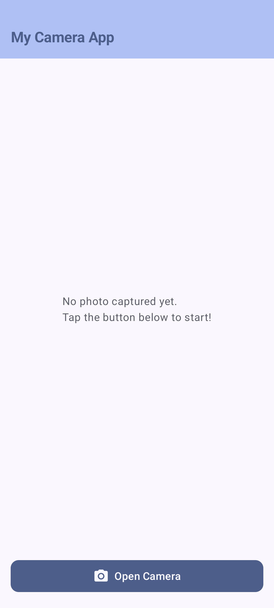
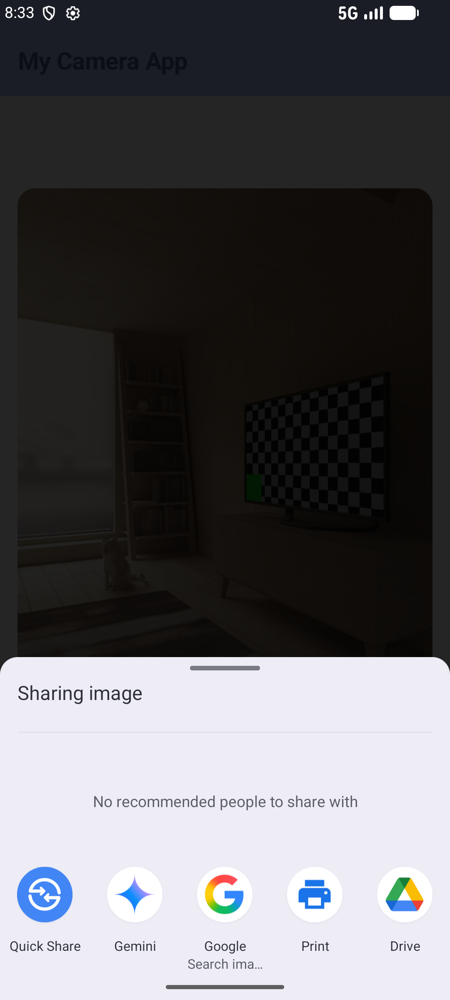

# Simple Camera App

A simple Android application built with Kotlin and Jetpack Compose that allows users to capture photos and share them using the Android System Sharing interface.

## Features
- Open device camera
- Capture photograph
- Display captured image in the app
- Share photo via system intents

## Screenshots

## How to Run
1. Clone the repository.
2. Open in Android Studio.
3. Run on an emulator or physical device.
